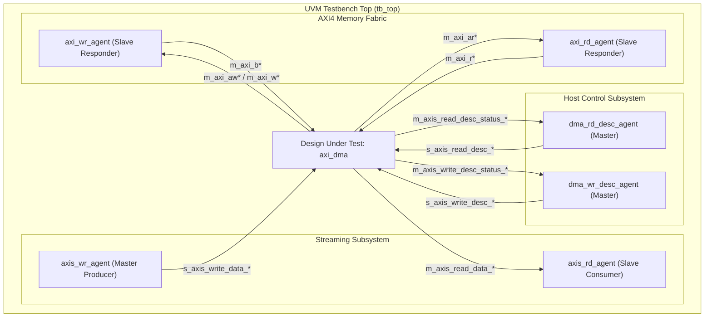
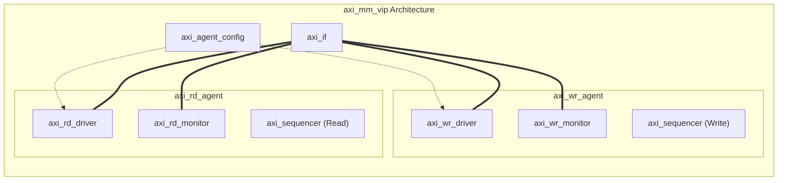
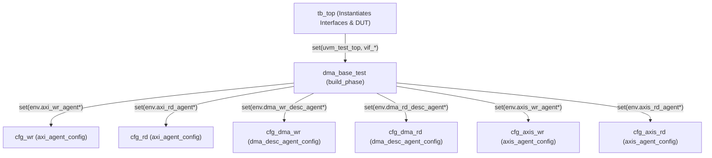

# Verification Platform & VIP Architecture

## 1. Executive Architectural Overview

The verification environment for the AMBA AXI4 Direct Memory Access (DMA) Subsystem is architected using the IEEE 1800.2 Universal Verification Methodology (UVM). The platform provides a modular, highly parameterizable, and protocol-compliant verification framework capable of evaluating both standalone intellectual property (IP) cores and fully integrated System-on-Chip (SoC) memory subsystems.

To eliminate verification bottlenecks and maximize stimulus controllability, the testbench incorporates three custom-designed parameterizable Verification Intellectual Properties (VIPs):
1. **AXI-MM VIP (`axi_mm_vip`):** A dual-channel memory-mapped verification component supporting Full AXI4 protocol semantics (AW, W, B, AR, R channels) with independent master and slave responder modes.
2. **AXIS VIP (`axis_vip`):** A high-throughput streaming verification component implementing the AMBA AXI4-Stream protocol with byte-level qualifiers (`TKEEP`), packet framing (`TLAST`), and routing attributes (`TID`, `TDEST`, `TUSER`).
3. **DMA Descriptor VIP (`dma_desc_vip`):** A dedicated control-plane verification component modeling the host software driver interface for scatter-gather descriptor queueing and status collection.

The platform is designed around a three-tier reconfigurable hardware topology, managed via compile-time directives (`+define+DMA_STANDALONE`, `+define+RAM_STANDALONE`, `+define+SUBSYSTEM`), allowing identical sequence and scoreboard assets to migrate from block-level core stress tests to full-system loopback verification.



## 2. Multi-Topology Testbench Configurations

The platform supports three distinct operational topologies selected via Verilog macros:

### Topology 1: Standalone DMA Mode (`+define+DMA_STANDALONE`)
* **Purpose:** Core-level feature extraction, protocol boundary stress, and microarchitectural corner-case closure.
* **Role Configuration:**
  * Descriptor Agents: Active Masters (driving descriptors, collecting status).
  * Stream Ingress Agent (`axis_wr_agent`): Active Master (driving data beats into DUT `s_axis_write_data_*`).
  * Stream Egress Agent (`axis_rd_agent`): Active Slave (sinking data beats from DUT `m_axis_read_data_*`).
  * AXI-MM Agents (`axi_wr_agent`, `axi_rd_agent`): **Active Slave Responders**. The memory VIP actively controls `AWREADY`, `WREADY`, `ARREADY`, injects read pipeline bubbles, and delays write completion `BVALID`.
* **Verification Advantage:** Maximizes stimulus controllability by decoupling DMA verification from static RAM behavior, allowing artificial backpressure injection on physical bus channels.

### Topology 2: Subsystem Integration Mode (`+define+SUBSYSTEM`)
* **Purpose:** System-level functional integrity, interconnect arbitration, and end-to-end memory loopback.
* **Role Configuration:**
  * The synthesizable RTL multi-channel SRAM core (`axi_ram.v`) is instantiated on the memory bus.
  * AXI-MM Agents switch dynamically to **Passive Monitors**, observing bus transactions without driving responses.
  * Descriptor and Stream agents remain active.
* **Verification Advantage:** Validates true end-to-end hardware loopback where DMA read transfers fetch real memory words previously committed by DMA write transfers.

### Topology 3: Standalone RAM Mode (`+define+RAM_STANDALONE`)
* **Purpose:** Independent characterization of the synthesizable SRAM IP.
* **Role Configuration:**
  * AXI-MM Agents operate as **Active Masters**, driving random write and read bursts directly into `axi_ram.v`.
* **Verification Advantage:** Validates SRAM arbitration, byte strobe decoding, and memory array retention in isolation.

## 3. AXI4 Memory-Mapped VIP (`axi_mm_vip`)

Located in [`uvm/vip/axi_mm_vip/`](file:///c:/Users/admin/OneDrive/Desktop/axi_vip_project/axi4_vip/uvm/vip/axi_mm_vip/), this VIP provides comprehensive modeling of the ARM AMBA AXI4 protocol (ARM IHI0022H).

### Architectural Decomposition
The VIP separates the write and read datapaths into independent agents to reflect the full-duplex nature of the AXI4 interconnect:
* `axi_wr_agent`: Owns the Write Address (AW), Write Data (W), and Write Response (B) channels.
* `axi_rd_agent`: Owns the Read Address (AR) and Read Data (R) channels.



### Component Breakdown
1. **Sequence Item ([`axi_seq_item.sv`](file:///c:/Users/admin/OneDrive/Desktop/axi_vip_project/axi4_vip/uvm/vip/axi_mm_vip/axi_seq_item.sv)):**
   * Implements transaction abstractions for both bursts and responses.
   * Parameterized with `DATA_WIDTH` (32-bit), `ADDR_WIDTH` (16-bit), `ID_WIDTH` (8-bit), and `STRB_WIDTH` (4-bit).
   * Encapsulates burst attributes: `addr`, `len` (AWLEN/ARLEN), `size` (AWSIZE/ARSIZE), `burst` (FIXED, INCR, WRAP).
   * Dynamic payload arrays: `data[]`, `strb[]`, `resp[]`, and per-beat timing delay arrays.
2. **Agent Configuration ([`axi_agent_config.sv`](file:///c:/Users/admin/OneDrive/Desktop/axi_vip_project/axi4_vip/uvm/vip/axi_mm_vip/axi_agent_config.sv)):**
   * Governs agent operational role (`is_active`, `is_master`).
   * Encapsulates memory slave responder timing knobs:
     * `enable_arready_stall`, `min_arready_delay`, `max_arready_delay`: Address read backpressure.
     * `enable_r_bubbles`, `min_r_bubble`, `max_r_bubble`: Data read channel bubble insertion.
     * `enable_awready_stall`, `min_awready_delay`, `max_awready_delay`: Address write backpressure.
     * `enable_wready_stall`, `wready_stall_period`, `wready_stall_cycles`: Periodic data write channel backpressure.
     * `bvalid_delay`: Memory commit latency before asserting `BVALID`.
3. **Write Driver ([`axi_wr_driver.sv`](file:///c:/Users/admin/OneDrive/Desktop/axi_vip_project/axi4_vip/uvm/vip/axi_mm_vip/axi_wr_driver.sv)):**
   * Implements multi-threaded parallel channel execution using SystemVerilog `fork ... join`.
   * **Slave Mode Logic:**
     * `slave_handle_aw()`: Monitors `AWVALID`, injects configured stall cycles on `AWREADY`, and stores burst metadata into internal FIFO `slv_aw_q`.
     * `slave_handle_w()`: Consumes `WDATA` beats, tracks beat counts, enforces periodic `WREADY = 0` stalls, and detects `WLAST`.
     * `slave_handle_b()`: Dequeues completed bursts from `slv_aw_q`, applies `bvalid_delay`, asserts `BVALID = 1` with `BRESP = AXI_RESP_OKAY`, and handshakes with `BREADY`.
4. **Read Driver ([`axi_rd_driver.sv`](file:///c:/Users/admin/OneDrive/Desktop/axi_vip_project/axi4_vip/uvm/vip/axi_mm_vip/axi_rd_driver.sv)):**
   * **Slave Mode Logic:**
     * `slave_handle_ar()`: Samples `ARVALID`, applies configured `ARREADY` backpressure, and queues read requests.
     * `slave_handle_r()`: Generates deterministic or randomized data beats, drives `RDATA`, asserts `RLAST` on the final beat, and inserts random clock bubbles between beats when `enable_r_bubbles = 1`.
5. **Monitors ([`axi_wr_monitor.sv`](file:///c:/Users/admin/OneDrive/Desktop/axi_vip_project/axi4_vip/uvm/vip/axi_mm_vip/axi_wr_monitor.sv), [`axi_rd_monitor.sv`](file:///c:/Users/admin/OneDrive/Desktop/axi_vip_project/axi4_vip/uvm/vip/axi_mm_vip/axi_rd_monitor.sv)):**
   * Non-intrusive listeners operating concurrently on the physical bus interface via clocking blocks.
   * Reassemble individual bus beats into comprehensive burst sequence items upon handshake completion (`WLAST` or `RLAST`).
   * Broadcast completed memory transactions to downstream subscribers via TLM analysis ports (`ap`).

## 4. AXI4-Stream VIP (`axis_vip`)

Located in [`uvm/vip/axis_vip/`](file:///c:/Users/admin/OneDrive/Desktop/axi_vip_project/axi4_vip/uvm/vip/axis_vip/), this VIP provides verification coverage for high-speed packetized streaming interfaces per ARM IHI0051B.

### Architectural Decomposition
* `axis_wr_agent`: Active Master producer driving the DMA write engine ingress (`s_axis_write_data_*`).
* `axis_rd_agent`: Active Slave consumer sinking the DMA read engine egress (`m_axis_read_data_*`).

### Component Breakdown
1. **Streaming Sequence Item ([`axis_seq_item.sv`](file:///c:/Users/admin/OneDrive/Desktop/axi_vip_project/axi4_vip/uvm/vip/axis_vip/axis_seq_item.sv)):**
   * Models complete stream packets bounded by `TLAST`.
   * Dynamic arrays for payload and qualifiers: `data[]` (32-bit payload), `keep[]` (byte enables), `user[]` (sideband attributes), `delay[]` (per-beat bubble cycles).
   * Header fields: `id` (stream source ID), `dest` (routing destination).
2. **Streaming Master Driver ([`axis_wr_driver.sv`](file:///c:/Users/admin/OneDrive/Desktop/axi_vip_project/axi4_vip/uvm/vip/axis_vip/axis_wr_driver.sv)):**
   * Translates abstract packet items into cycle-by-cycle physical bus signals.
   * Evaluates `item.delay[i]` per beat: when non-zero, deasserts `tvalid <= 1'b0` and executes `repeat (delay) @(vif.mst_drv_cb)`.
   * Drives payload and asserts `tvalid <= 1'b1`.
   * Enforces strict protocol compliance: holds `tdata`, `tkeep`, and `tlast` constant until `tready` is sampled high.
3. **Streaming Slave Driver ([`axis_rd_driver.sv`](file:///c:/Users/admin/OneDrive/Desktop/axi_vip_project/axi4_vip/uvm/vip/axis_vip/axis_rd_driver.sv)):**
   * Acts as an elastic stream sink.
   * Controls `tready` backpressure: supports continuous wire-speed consumption (`tready = 1`) or randomized duty-cycle throttling to backpressure the DMA egress.
4. **Packet Sequence Architecture ([`sequences/axis_packet_seq.sv`](file:///c:/Users/admin/OneDrive/Desktop/axi_vip_project/axi4_vip/uvm/vip/axis_vip/sequences/axis_packet_seq.sv)):**
   * Features fine-grained handshake timing knobs:
     * `num_packets`: Number of packets to generate.
     * `min_beats` / `max_beats`: Packet length boundaries in beats.
     * `force_full_last_keep`: Forces final beat `TKEEP = 4'b1111`.
     * `forced_last_keep`: Forces specific trailing byte lane pattern (e.g., `4'b0001`, `4'b0011`, `4'b0111`) for partial length testing.
     * `initial_delay`: Idle bubble cycles (`TVALID = 0`) before beat 0 of packet 0 (used for descriptor-first timing skew).
     * `inter_beat_delay`: Idle bubble cycles inserted between consecutive beats within a packet.
     * `enable_random_beat_delay`: If 1, randomizes delay in `[0 : inter_beat_delay]`; if 0, enforces deterministic stall.
     * `inter_packet_delay`: Idle bubble cycles between consecutive packets (after `TLAST`).

## 5. DMA Descriptor VIP (`dma_desc_vip`)

Located in [`uvm/vip/dma_desc_vip/`](file:///c:/Users/admin/OneDrive/Desktop/axi_vip_project/axi4_vip/uvm/vip/dma_desc_vip/), this VIP models host processor interactions with the DMA scatter-gather command and status FIFOs.

### Architectural Decomposition
* `dma_rd_desc_agent`: Manages MM2S read command issuing (`s_axis_read_desc_*`) and status retirement (`m_axis_read_desc_status_*`).
* `dma_wr_desc_agent`: Manages S2MM write command issuing (`s_axis_write_desc_*`) and status retirement (`m_axis_write_desc_status_*`).

### Component Breakdown
1. **Descriptor Sequence Item ([`dma_desc_seq_item.sv`](file:///c:/Users/admin/OneDrive/Desktop/axi_vip_project/axi4_vip/uvm/vip/dma_desc_vip/dma_desc_seq_item.sv)):**
   * Command parameters:
     * `addr`: Start memory address (16-bit).
     * `len`: Transfer byte count (20-bit, up to 1MB).
     * `tag`: Transaction identification tag (8-bit) for out-of-order tracking.
     * `valid_delay`: Inter-descriptor idle cycles before asserting valid.
   * Status parameters:
     * `status_len`: Actual transferred byte count reported by hardware.
     * `status_tag`: Tag of the retiring transfer.
     * `status_error`: Error status code (`DMA_ERR_NONE = 0x0`, `DMA_ERR_AXI_SLVERR = 0x1`, `DMA_ERR_AXI_DECERR = 0x2`).
2. **Descriptor Drivers ([`dma_rd_desc_driver.sv`](file:///c:/Users/admin/OneDrive/Desktop/axi_vip_project/axi4_vip/uvm/vip/dma_desc_vip/dma_rd_desc_driver.sv), [`dma_wr_desc_driver.sv`](file:///c:/Users/admin/OneDrive/Desktop/axi_vip_project/axi4_vip/uvm/vip/dma_desc_vip/dma_wr_desc_driver.sv)):**
   * Manages hardware enable pins: asserts `read_enable = 1` and `write_enable = 1` upon reset release.
   * Evaluates `valid_delay`: introduces controlled spacing between descriptor submissions to test command FIFO pipelining.
   * Drives command payload and waits for hardware handshake (`read_desc_ready` / `write_desc_ready`).
3. **Descriptor Monitors ([`dma_rd_desc_monitor.sv`](file:///c:/Users/admin/OneDrive/Desktop/axi_vip_project/axi4_vip/uvm/vip/dma_desc_vip/dma_rd_desc_monitor.sv), [`dma_wr_desc_monitor.sv`](file:///c:/Users/admin/OneDrive/Desktop/axi_vip_project/axi4_vip/uvm/vip/dma_desc_vip/dma_wr_desc_monitor.sv)):**
   * Dual-channel monitoring:
     * Port 1 (`ap_cmd`): Samples accepted command descriptors upon valid-ready handshake.
     * Port 2 (`ap_status`): Samples status retirement pulses when `status_valid = 1`.
   * Feeds both command intent and completion reports to the scoreboard.

## 6. Physical Interface Layer & Clocking Synchronization

The physical pin connections are abstracted through three SystemVerilog interfaces located in [`uvm/interfaces/`](file:///c:/Users/admin/OneDrive/Desktop/axi_vip_project/axi4_vip/uvm/interfaces/):
* [`axi_if.sv`](file:///c:/Users/admin/OneDrive/Desktop/axi_vip_project/axi4_vip/uvm/interfaces/axi_if.sv): Memory-mapped bus interface.
* [`axis_if.sv`](file:///c:/Users/admin/OneDrive/Desktop/axi_vip_project/axi4_vip/uvm/interfaces/axis_if.sv): Streaming bus interface.
* [`dma_desc_if.sv`](file:///c:/Users/admin/OneDrive/Desktop/axi_vip_project/axi4_vip/uvm/interfaces/dma_desc_if.sv): Descriptor control interface.

### Race-Free Clocking Block Methodology
To eliminate zero-time race conditions, hold-time violations, and non-deterministic simulator delta-cycle glitches, all driver and monitor components interact with physical wires strictly via **SystemVerilog Clocking Blocks**:

```systemverilog
clocking wr_slv_drv_cb @(posedge clk);
    default input #1ns output #1ns;
    input  awid, awaddr, awlen, awsize, awburst, awvalid;
    output awready;
    input  wdata, wstrb, wlast, wvalid;
    output wready;
    output bid, bresp, bvalid;
    input  bready;
endclocking
```

* **Setup Skew (`input #1ns`):** Samples signal states 1ns prior to the rising clock edge, guaranteeing stable, glitch-free values matching physical register hold times.
* **Clock-to-Out Drive Delay (`output #1ns`):** Drives signals 1ns after the active clock edge, simulating physical cell propagation delay ($T_{co}$) and avoiding setup violations in synchronous DUT logic.

## 7. Config DB Hierarchical Distribution

The environment propagates virtual interface handles and configuration parameters through the `uvm_config_db` hierarchy:



This decoupled configuration scheme enables individual tests to dynamically alter responder behaviors (such as enabling write backpressure stalls) in their own `build_phase` or `run_phase` without touching environment or agent code.
